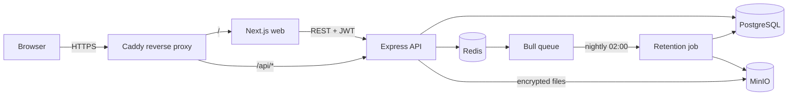

# BakımEvi — Care Facility Management System

**Patient tracking and encrypted document management for elderly and disability care facilities.**

[](https://github.com/arslannizzetali/bakim-merkezi/actions/workflows/ci.yml)


🇹🇷 [Türkçe README](README.tr.md)

<!-- TODO(izzet): add screenshots (dashboard, patient detail, document upload) to docs/screenshots/ and reference them here. Use seed data only — never real patient data. -->

## Why this project?

Care facilities that look after elderly and disabled residents still track much of their daily work on paper: medication given, vital signs, incidents, and the documents that come with each resident. That makes it hard to see who did what, and sensitive health documents end up in folders and shared drives.

BakımEvi gives care staff one place to record daily patient updates and store documents, with role-based access, encryption of sensitive data, and an audit trail of who viewed or changed what.

The project was designed and built in response to the requirements of a care facility.

<!-- TODO(izzet): once delivered, add: number of staff users, number of residents, and how long it has been in use. -->

## Features

- **Patient records** — registration, search and filters (status, care type, mobility, admission date), quick access by room number
- **Daily updates** — medication, care performed, observation, vital signs, status change and incident entries, with mood tracking and an urgent flag
- **Document management** — upload PDF, JPEG, PNG, WEBP, DOCX and XLSX files with a priority:

  | Priority | Meaning | Rule |
  | --- | --- | --- |
  | `RED` | Critical | Can never be deleted, by any role |
  | `YELLOW` | Semi-important | Admin can delete; auto-deleted after 90 days by default |
  | `GREEN` | Standard | Admin can delete; auto-deleted after 30 days by default |

- **Admin panel** — employee management, all patients and updates, recent/urgent updates, audit log viewer, retention policy settings
- **Multi-tenant deployment** — one script provisions an isolated database, Redis index, storage bucket, containers and HTTPS subdomain per facility

### Roles and permissions

| Action | Admin | Employee |
| --- | :-: | :-: |
| Create, delete, list employees | ✅ | ❌ |
| View all audit logs | ✅ | ❌ |
| View all patient updates | ✅ | ❌ |
| Create and view patients | ✅ | ✅ |
| Delete patients (soft delete) | ✅ | ❌ |
| Enter patient updates / view own updates | ✅ | ✅ |
| Upload documents | ✅ | ✅ |
| Download own documents | ✅ | ✅ |
| Download another employee's documents | ✅ | ❌ |
| Delete `RED` documents | ❌ | ❌ |
| Delete `YELLOW` / `GREEN` documents | ✅ | ❌ |
| Change retention policies | ✅ | ❌ |

Every row is covered by an integration test in [`tests/integration/permission-matrix.integration.test.ts`](tests/integration/permission-matrix.integration.test.ts).

## Security design

- **Files** are encrypted with AES-256-GCM before they reach object storage. Each file gets its own random key and IV; the file key is wrapped with a master key (envelope encryption) and the GCM auth tag plus a SHA-256 checksum are verified on download.
- **National ID (TC) numbers** are encrypted with AES-256-GCM and a random IV per value.
- **Authentication** uses short-lived JWT access tokens and refresh tokens in an `httpOnly` cookie. Refresh tokens are single-use and rotated; reusing one revokes the whole session family.
- **Brute-force protection** — Redis-backed rate limiting plus a per account/IP lockout after repeated failed logins.
- **Uploads** are checked by extension, declared MIME type *and* file signature (magic bytes), limited to 50 MB, and stored under a random UUID name.
- **Audit log** records logins, failed logins, patient views/searches/changes and document actions. The application never updates or deletes audit entries.
- **Hardening** — Helmet security headers and CSP, CORS restricted to configured origins, Zod validation on every input, bcrypt (cost 12) password hashing, startup fails in production if secrets are missing or default MinIO credentials are used.

Details: [`docs/DATA_PROTECTION.md`](docs/DATA_PROTECTION.md).

## Tech stack

| Layer | Choice | Why |
| --- | --- | --- |
| Frontend | Next.js 14 (App Router), React 18, Tailwind CSS, TanStack Query, Zustand, React Hook Form + Zod | Server/client rendering in one framework; Query handles caching and token refresh retries |
| API | Express 4, TypeScript | Small, explicit middleware chain that is easy to audit for a security-sensitive app |
| Database | PostgreSQL 16 + Prisma 5 | Relational data with strong typing and versioned migrations |
| Cache / queue | Redis 7 + Bull | Rate limiting, token state and the nightly retention job |
| Object storage | MinIO (S3-compatible) | Self-hosted, so health documents never leave the facility's infrastructure |
| Validation | Zod, shared between web and API (`packages/validation`) | One source of truth for input rules |
| Tooling | pnpm workspaces, Turbo, Vitest, ESLint, Prettier, GitHub Actions | |

## Architecture



In production each facility (tenant) gets its own `web` and `api` containers, PostgreSQL database and role, Redis database index and MinIO bucket, behind a shared Caddy instance that terminates HTTPS. See [`docs/DEPLOYMENT.md`](docs/DEPLOYMENT.md).

<!-- TODO(izzet): confirm the production setup described above (internet-facing server with Caddy + HTTPS, one tenant per facility) matches how you will deliver it. -->

## Getting started

**Requirements:** Node.js 22, Corepack, Docker.

```bash
corepack enable
corepack pnpm install
corepack pnpm generate:secrets   # writes JWT and encryption keys to .env

docker compose up -d             # PostgreSQL, Redis, MinIO

corepack pnpm db:generate
corepack pnpm db:migrate         # prisma migrate dev
corepack pnpm db:seed            # development data only
corepack pnpm dev
```

- Web: http://localhost:3000
- API: http://localhost:3001 — readiness check at `/health`, liveness at `/health/live`
- MinIO console: http://localhost:9001

**Development seed users** are created by `pnpm db:seed`. Their passwords come from `SEED_ADMIN_PASSWORD` and `SEED_EMPLOYEE_PASSWORD` in `.env`; if those are empty, random passwords are generated and printed once. The seed refuses to run with `NODE_ENV=production`.

## Running tests

```bash
corepack pnpm lint
corepack pnpm typecheck
corepack pnpm test                                     # unit tests
RUN_INTEGRATION=true corepack pnpm --filter @bakimevi/api test   # needs a seeded test DB, Redis, MinIO
```

CI runs all of the above on every push, including the integration suite against PostgreSQL, Redis and MinIO containers and a check that migrations match `schema.prisma`.

## Project structure

```text
bakim-merkezi/
├── apps/
│   ├── api/                 # Express API, Prisma schema, migrations, seed
│   └── web/                 # Next.js frontend
├── packages/
│   ├── shared-types/        # Types shared by web and API
│   └── validation/          # Zod schemas shared by web and API
├── tests/                   # Unit and integration tests
├── deploy/                  # Production Docker Compose and Caddy config
├── scripts/                 # Tenant lifecycle and secret generation scripts
├── docs/                    # Deployment and data protection docs
├── research/, security/     # Design notes written as AI agent briefs (see below)
└── docker-compose.yml       # Local PostgreSQL, Redis, MinIO
```

## Known limitations and roadmap

- Clinical fields (diagnosis, allergies, medications, update notes) are protected by access control and database/disk security but are not encrypted at the column level.
- Audit log immutability is enforced in application code; a database-level guard (revoked `UPDATE`/`DELETE` or a trigger) is planned.
- Next.js 14 and Multer 1.x have published advisories that are fixed only in new major versions; upgrading to Next.js 15 and Multer 2 is planned.
- No key rotation tooling yet for `MASTER_ENCRYPTION_KEY`.
- No e-mail/SMS notifications for urgent updates.

## AI-assisted development

<!-- TODO(izzet): describe which AI tools you used (e.g. Codex, Claude), at which stages (scaffolding, tests, docs, reviews), and which parts you designed and decided yourself (architecture, security model, permission rules, client requirements). -->

The `AGENTS.md` files in the root and in `apps/`, `research/`, `security/`, `tests/` and `src/ui/` are instruction files for AI coding agents: they describe the project rules, security requirements and conventions each agent had to follow. `docs/codex-komutlari.md` lists the prompts used to run them.

## License

<!-- TODO(izzet): choose a license. This is a commercial client project; "All rights reserved" (no license file) is the default until you decide. -->

All rights reserved. The source is published for portfolio purposes.

## Contact

İzzet Ali Arslan — [GitHub](https://github.com/arslannizzetali)

<!-- TODO(izzet): add LinkedIn / e-mail if you want them public. -->
