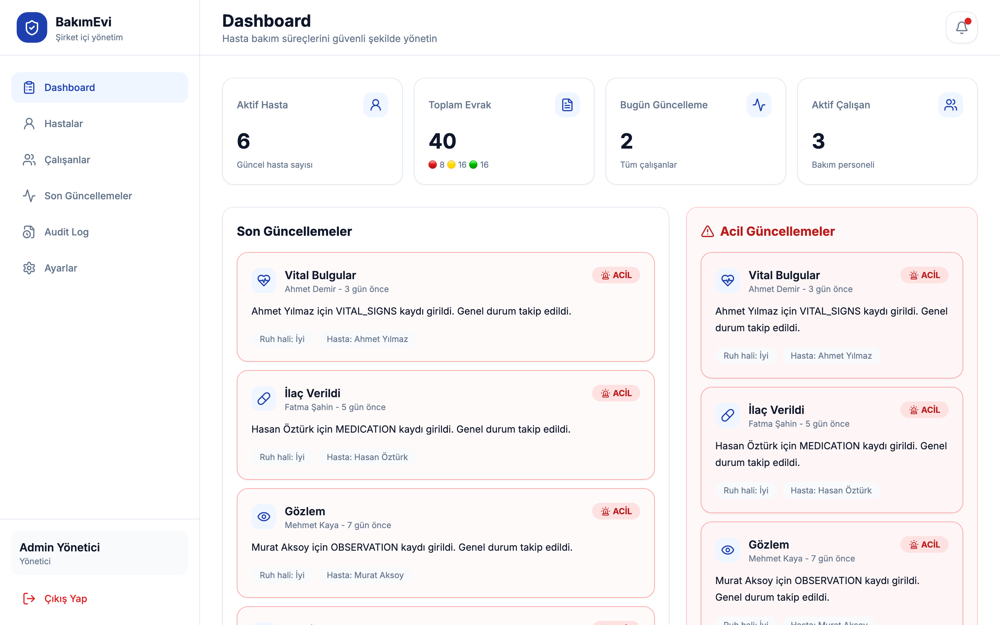
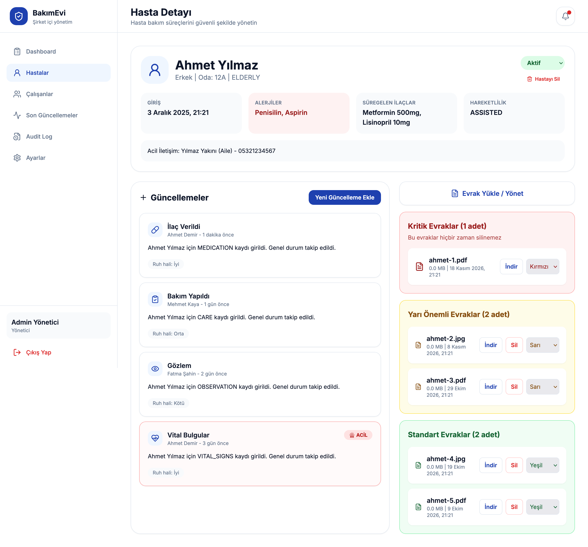
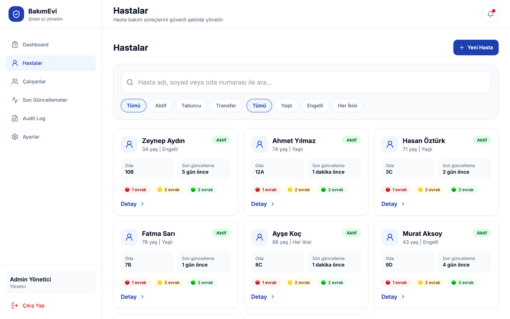
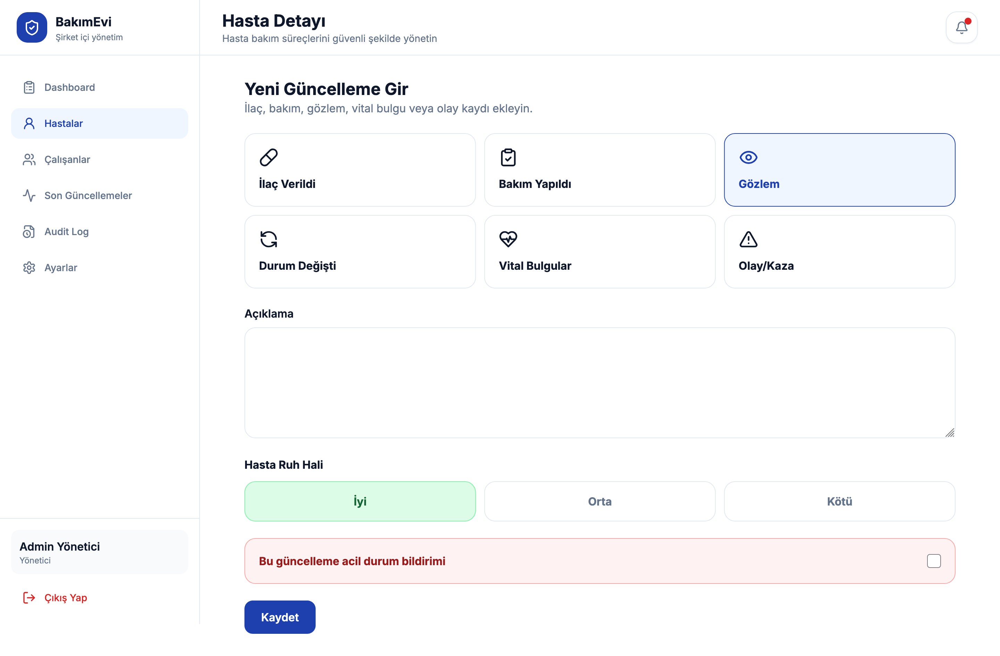
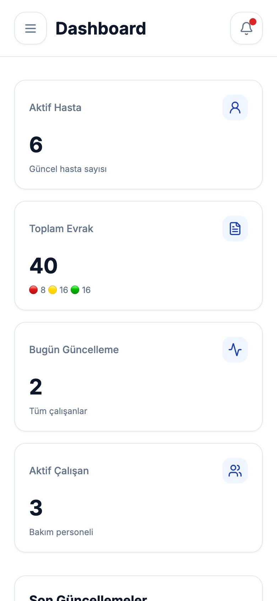

# BakımEvi — Bakım Merkezi Yönetim Sistemi

**Yaşlı ve engelli bakım merkezleri için hasta takibi ve şifreli evrak yönetimi.**

🇬🇧 [English README](README.md)


## Neden bu proje?

Yaşlı ve engelli bireylere hizmet veren bakım merkezlerinde günlük iş (verilen ilaç, vital bulgular, olaylar, hastaya ait evraklar) hâlâ büyük ölçüde kâğıt üzerinde tutuluyor. Bu durumda kimin ne yaptığını izlemek zorlaşıyor; hassas sağlık evrakları da klasörlerde ve paylaşılan sürücülerde kalıyor.

BakımEvi bakım personeline günlük hasta güncellemelerini girip evrakları saklayabileceği tek bir yer sunar. Rol bazlı erişim, hassas verilerin şifrelenmesi ve kimin neyi görüntülediğini ya da değiştirdiğini kaydeden bir denetim kaydı içerir.

Proje bir bakım merkezinin talebi ve ihtiyaçları üzerine tasarlanıp geliştirilmiştir. Bu herkese açık depo yalnızca uygulama kodunu ve tamamen sahte demo verisini içerir; gerçek bir kuruma, hastaya veya personele ait hiçbir bilgi barındırmaz.


## Ekran görüntüleri

_Tüm görüntüler `pnpm db:seed` ile yüklenen sahte demo verisiyle alınmıştır; gerçek hasta veya personel bilgisi içermez._



<table>
  <tr>
    <td></td>
    <td></td>
  </tr>
  <tr>
    <td align="center">Önceliklendirilmiş evraklarla hasta detayı</td>
    <td align="center">Hasta listesi ve filtreler</td>
  </tr>
  <tr>
    <td></td>
    <td align="center"></td>
  </tr>
  <tr>
    <td align="center">Günlük güncelleme formu</td>
    <td align="center">Mobil görünüm</td>
  </tr>
</table>

## Özellikler

- **Hasta kayıtları** — kayıt, arama ve filtreleme (durum, bakım türü, mobilite, giriş tarihi), oda numarasıyla hızlı erişim
- **Günlük güncellemeler** — ilaç, bakım, gözlem, vital bulgular, durum değişikliği ve olay/kaza kayıtları; ruh hali takibi ve acil işareti
- **Evrak yönetimi** — PDF, JPEG, PNG, WEBP, DOCX ve XLSX yükleme, önceliklendirme:

  | Öncelik | Anlam | Kural |
  | --- | --- | --- |
  | `RED` | Kritik | Hiçbir rol tarafından silinemez |
  | `YELLOW` | Yarı önemli | Admin silebilir; varsayılan 90 gün sonra otomatik silinir |
  | `GREEN` | Standart | Admin silebilir; varsayılan 30 gün sonra otomatik silinir |

- **Admin paneli** — çalışan yönetimi, tüm hastalar ve güncellemeler, son/acil güncellemeler, denetim kaydı, saklama politikası ayarları
- **Çok kiracılı (multi-tenant) dağıtım** — tek bir script her kurum için ayrı veritabanı, Redis index'i, depolama bucket'ı, container'lar ve HTTPS alt alan adı oluşturur

Yetki matrisi, güvenlik tasarımı, mimari ve teknoloji seçimleri için [İngilizce README](README.md) bölümlerine bakın; her yetki satırı bir entegrasyon testiyle korunur.

## Kurulum

**Gereksinimler:** Node.js 22, Corepack, Docker.

```bash
corepack enable
corepack pnpm install
corepack pnpm generate:secrets   # JWT ve şifreleme anahtarlarını .env'e yazar

docker compose up -d             # PostgreSQL, Redis, MinIO

corepack pnpm db:generate
corepack pnpm db:migrate         # prisma migrate dev
corepack pnpm db:seed            # yalnızca geliştirme verisi
corepack pnpm dev
```

- Web: http://localhost:3000
- API: http://localhost:3001 — hazır olma kontrolü `/health`, canlılık kontrolü `/health/live`
- MinIO konsolu: http://localhost:9001

**Geliştirme seed kullanıcıları** `pnpm db:seed` ile oluşturulur. Şifreleri `.env` içindeki `SEED_ADMIN_PASSWORD` ve `SEED_EMPLOYEE_PASSWORD` değişkenlerinden okunur; boşsa rastgele şifre üretilip terminale bir kez yazdırılır. Seed, `NODE_ENV=production` ortamında çalışmayı reddeder.

### Demo verisi

`pnpm db:seed` tamamen sahte bir demo veri seti yükler: dört personel hesabı (`admin@demo.example`, `ahmet@demo.example`, `mehmet@demo.example`, `fatma@demo.example`), uydurma isimli sekiz hasta, geçerli olmayan yer tutucu TC numaraları (`1000000000x`), yer tutucu telefon numarası, örnek güncellemeler ve küçük üretilmiş PDF/JPEG evraklar. `.example` e-posta alamayan, ayrılmış bir alan adıdır.

### Güvenlik tasarımı (özet)

- Varsayılan hesap veya parola yoktur. Seed parolaları `.env`'de verilmezse rastgele üretilir; canlı kurulumda ilk admin parolası `scripts/tenant-create.sh` tarafından rastgele üretilip bir kez gösterilir.
- Başkasının belirlediği her parola (kurulum script'i ya da admin'in oluşturduğu/sıfırladığı çalışan parolası) ilk girişte değiştirilmek zorundadır; değiştirilene kadar API diğer tüm istekleri `PASSWORD_CHANGE_REQUIRED` ile reddeder.
- Evraklar dosya başına rastgele anahtar ve IV ile AES-256-GCM şifrelenir, anahtar master key ile sarılır (envelope encryption). TC numaraları her değer için rastgele IV ile şifrelenir.
- Kısa ömürlü JWT access token, `httpOnly` cookie'de tek kullanımlık ve atomik döndürülen refresh token; tekrar kullanımda tüm oturum ailesi iptal edilir, parola değişince eski tüm token'lar geçersiz olur.
- IP+hesap ve IP'den bağımsız hesap bazlı brute-force kilidi, Redis tabanlı rate limit, yalnızca izinli origin'lere CORS, her girdide Zod doğrulaması.
- `NODE_ENV` tanımsızsa, secret'lar eksik/hatalıysa ya da production'da varsayılan MinIO bilgileri kullanılıyorsa uygulama başlamaz; production'da stack trace döndürülmez.

Ayrıntılar: [`docs/ENCRYPTION.md`](docs/ENCRYPTION.md), [`docs/DATA_PROTECTION.md`](docs/DATA_PROTECTION.md).

### Canlı kurulum

Kurumlar `scripts/tenant-create.sh` ile kurulur; script tüm secret'ları `openssl rand` ile üretir ve demo verisi yüklemez. Ayrıntılar için [`docs/DEPLOYMENT.md`](docs/DEPLOYMENT.md) ve [`docs/PRE_LAUNCH_CHECKLIST.md`](docs/PRE_LAUNCH_CHECKLIST.md). TC numaralarında rastgele IV'den önce kurulmuş sistemlerde, yedek aldıktan sonra bir kez şu script çalıştırılmalıdır:

```bash
cd apps/api
corepack pnpm exec tsx prisma/reencrypt-legacy-tc.ts          # deneme (değişiklik yapmaz)
corepack pnpm exec tsx prisma/reencrypt-legacy-tc.ts --apply
```

## Testler

```bash
corepack pnpm lint
corepack pnpm typecheck
corepack pnpm test
RUN_INTEGRATION=true corepack pnpm --filter @bakimevi/api test   # seed'lenmiş test DB, Redis ve MinIO gerekir
```

## KVKK notları

BakımEvi, KVKK (6698 sayılı Kanun) kapsamında özel nitelikli kişisel veri olan sağlık verisi işler. Yazılım teknik tedbirler sunar (TC ve evrak şifreleme, rol bazlı erişim, denetim kaydı, ayarlanabilir saklama süreleri, intranet öncelikli kurulum); ancak uyum, sistemi işleten kurumun süreçlerine de bağlıdır. Sistemi kuran kurum veri sorumlusudur ve diğerlerinin yanında şunlardan sorumludur:

- gerekiyorsa VERBİS kaydı ve kişisel veri işleme envanteri,
- hasta, yakınları ve personel için aydınlatma metni ve gereken yerlerde açık rıza,
- sunucunun, yedeklerin ve `MASTER_ENCRYPTION_KEY`'in kendi kontrolündeki altyapıda tutulması,
- yasal yükümlülüklere uygun saklama sürelerinin belirlenmesi,
- ilgili kişilerin erişim ve silme taleplerinin karşılanması.

Saklanan her alan ve nasıl korunduğu [`docs/DATA_PROTECTION.md`](docs/DATA_PROTECTION.md) dosyasındadır. Bu bölüm hukuki tavsiye değildir.

## Bilinen sınırlamalar ve yol haritası

- Klinik alanlar (tanı, alerjiler, ilaçlar, güncelleme notları) erişim kontrolü ve veritabanı/disk güvenliğiyle korunur, ancak sütun düzeyinde şifrelenmez.
- Denetim kaydının değiştirilemezliği uygulama kodunda sağlanır; veritabanı düzeyinde koruma planlanıyor.
- Next.js 14 ve Multer 1.x'teki bazı güvenlik açıkları yalnızca yeni ana sürümlerde düzeltildi; Next.js 15 ve Multer 2'ye geçiş planlanıyor.
- `MASTER_ENCRYPTION_KEY` için anahtar rotasyonu aracı henüz yok; şifreli değerler satıra GCM AAD ile bağlanmıyor.
- Çok kiracılı kurulumda kurumlar tek bir Redis'i ve parolasını paylaşıyor, yalnızca DB index ile ayrılıyor; kurum başına Redis veya ACL kullanıcısı planlanıyor.

## Geliştirme geçmişi

Proje önce yerelde geliştirildi, bu repoya sonradan toplu olarak aktarıldı; commit geçmişinin kısa olmasının nedeni budur. Şifreleme tasarımı [`docs/ENCRYPTION.md`](docs/ENCRYPTION.md) dosyasında anlatılır.

## Yapay zekâ destekli geliştirme


Geliştirmede yapay zekâ kod ajanları kullanıldı. Kökteki ve `apps/`, `research/`, `security/`, `tests/`, `src/ui/` altındaki `AGENTS.md` dosyaları bu ajanların uyduğu proje kuralları, güvenlik gereksinimleri ve kodlama standartlarıdır.

## Lisans

Telif hakkı © 2026 İzzet Ali Arslan. Tüm hakları saklıdır — bkz. [`LICENSE`](LICENSE). Kaynak kod yalnızca portföy ve değerlendirme amacıyla yayınlanmıştır; yazılı izin olmadan kullanılamaz, kopyalanamaz, değiştirilemez veya dağıtılamaz.

## İletişim

İzzet Ali Arslan — [GitHub](https://github.com/arslannizzetali)
