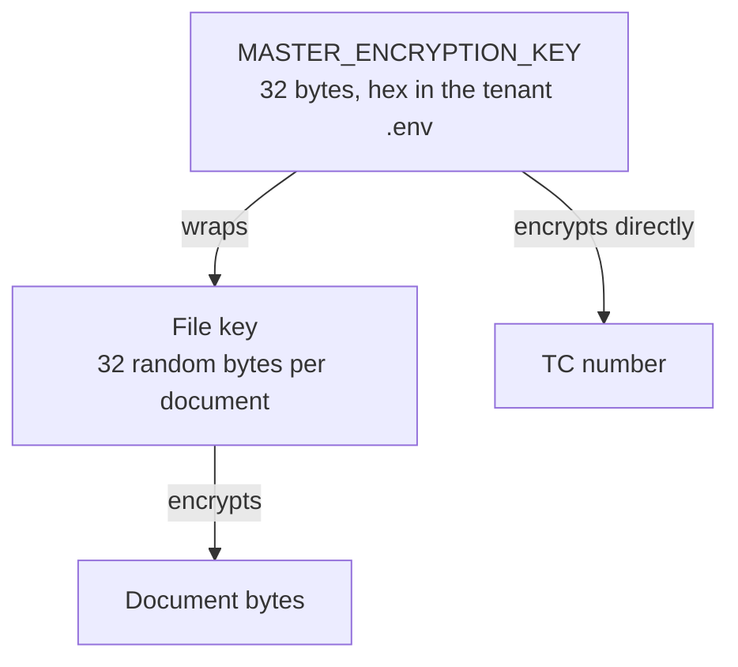

# Encryption design

This document describes how BakımEvi encrypts data at rest, as implemented in
[`apps/api/src/services/encryption.service.ts`](../apps/api/src/services/encryption.service.ts)
and used by [`document.service.ts`](../apps/api/src/services/document.service.ts).
It covers what the code does today, including its known gaps. For the wider data
protection picture (access control, audit log, retention) see
[`DATA_PROTECTION.md`](DATA_PROTECTION.md).

## What is encrypted

| Data | Where it is stored | Protection |
| --- | --- | --- |
| Uploaded documents | MinIO bucket, under a random UUID name | AES-256-GCM, one random key per file |
| Per-file keys | `documents.encryption_key` (PostgreSQL) | Wrapped with the master key (AES-256-GCM) |
| National ID (TC) numbers | `patients.tc_number_encrypted` | AES-256-GCM with the master key |
| Clinical fields (diagnosis, allergies, medications, update notes) | `patients`, `patient_updates` | Not column-encrypted |

All cryptography uses Node.js `node:crypto`; there is no custom cipher code.

## Key hierarchy



- **Master key** — `MASTER_ENCRYPTION_KEY`, 64 hex characters (256 bits). It is
  validated at startup (`config/index.ts`) and read once into memory when the
  encryption module loads. It is generated by `scripts/generate-secrets.ts`
  for development and by `openssl rand -hex 32` in `scripts/tenant-create.sh`
  for each tenant.
- **File keys** — 32 bytes from `crypto.randomBytes`, generated for every
  upload and never reused.

## Document upload (envelope encryption)

`encryptFile(buffer)`:

1. Compute the SHA-256 checksum of the plaintext.
2. Generate a random 32-byte file key and a random 16-byte IV.
3. Encrypt the file with AES-256-GCM and take the 16-byte auth tag.
4. Wrap the file key: encrypt it with the master key using AES-256-GCM and a
   second random 16-byte IV, producing `{ key, iv, authTag }`.

`document.service.ts` then uploads the ciphertext to MinIO as
`application/octet-stream` and stores one JSON value in
`documents.encryption_key`:

```json
{
  "wrappedKey": { "key": "…", "iv": "…", "authTag": "…" },
  "fileIv": "…",
  "fileAuthTag": "…"
}
```

The plaintext checksum is stored in `documents.checksum`.

## Document download

1. Fetch the ciphertext from MinIO.
2. Unpack the JSON, unwrap the file key with the master key (the GCM tag of the
   wrapped key is verified).
3. Decrypt the file; `decipher.final()` throws if the file auth tag does not
   match, so a modified ciphertext is rejected.
4. Recompute SHA-256 of the plaintext and compare it with the stored checksum.

## TC number encryption

`encryptTc(tc)` encrypts the value directly with the master key using
AES-256-GCM and a fresh random 12-byte IV, and stores
`{ v: 2, iv, data, authTag }` as JSON. The output is different on every call,
so TC numbers cannot be searched by equality in the database.

`decryptTc` also accepts a legacy format without an `iv` field, which was
encrypted with an all-zero IV. That format is read-only: nothing in the code
writes it any more.

## IVs and auth tags

| Use | IV | Source | Tag |
| --- | --- | --- | --- |
| File content | 16 bytes | `crypto.randomBytes`, new per file, with a new key per file | 16 bytes |
| File-key wrapping | 16 bytes | `crypto.randomBytes`, new per wrap | 16 bytes |
| TC number | 12 bytes | `crypto.randomBytes`, new per value | 16 bytes |

## Where keys live

- The master key exists only in the tenant's `.env` file on the server and in
  the API process memory. It is not in the database or the repository.
- Wrapped file keys live in PostgreSQL; ciphertext lives in MinIO. A database
  dump or a bucket copy on its own does not reveal document contents.
- Backups must include the tenant `.env` separately from the data
  (see [`DEPLOYMENT.md`](DEPLOYMENT.md)); without the master key the documents
  and TC numbers cannot be decrypted.

## Key rotation

There is no rotation tooling. Rotating the master key today would mean a
one-off script that unwraps and re-wraps every file key and re-encrypts every
TC number. Because file contents are encrypted with per-file keys, the files
in MinIO would not need to be re-encrypted. Wrapped keys carry no key
identifier, so two master keys cannot coexist during a rotation.

## Known gaps

1. **Legacy zero-IV TC values.** Values written by the old format share one
   key and one IV, which breaks GCM's confidentiality and integrity guarantees
   for those values. The code still decrypts them but there is no migration
   that re-encrypts them with a random IV.
2. **Master key in a plaintext `.env`.** Anyone with read access to the server
   file system or the process environment can decrypt everything. There is no
   KMS, HSM or secret manager.
3. **No key rotation and no key versioning** (see above).
4. **One key, two purposes.** The master key both wraps file keys and encrypts
   TC numbers; there is no key derivation (for example HKDF) to separate them.
5. **16-byte IVs for files and key wrapping.** GCM is specified for 12-byte
   IVs; other lengths are allowed but not recommended. TC encryption already
   uses 12 bytes.
6. **No additional authenticated data.** Ciphertexts are not bound to the
   document or patient they belong to, so someone with write access to both
   the database and the bucket could swap one record's ciphertext and key for
   another's without detection.
7. **Plaintext checksum in the database.** Identical files produce identical
   checksums, which reveals that two documents are the same.
8. **Whole-file buffering.** Uploads are held in memory (multer memory
   storage, 50 MB limit) and encrypted in one pass rather than streamed.
9. **Clinical fields are not column-encrypted**; they rely on access control
   and disk/database security.
